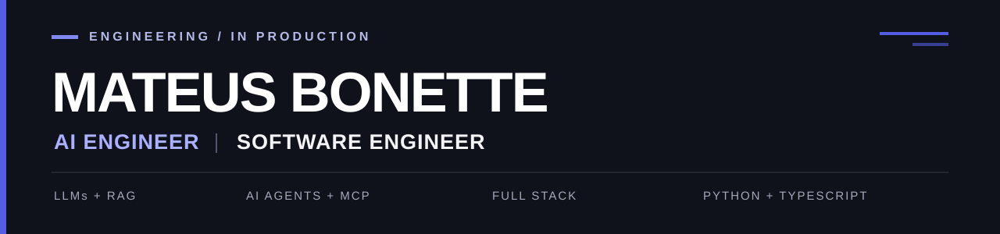

  <a href="https://mateusbonette.com.br">Portfolio</a> ·
  <a href="https://www.linkedin.com/in/mateus-bonette/">LinkedIn</a> ·
  <a href="mailto:mateus.bonette00@gmail.com">Email</a> ·
  <a href="README.pt-BR.md">Português</a>

# Hi, I'm Mateus.

**Applied AI Engineer & Software Engineer** building dependable AI products and full-stack systems for real users.

I work across the entire product lifecycle: architecture, Python/FastAPI backends, TypeScript frontends, PostgreSQL, LLM integrations, deployment, and observability. My focus is making **LLMs, RAG, agents, and automation work reliably in production**, rather than building demos that stop at a prompt.

I'm a co-founder and engineer at **Junta Já Brasil**, a financial-management SaaS that integrates AI into real business workflows. Previously, I built AI-powered and full-stack solutions at **Moontech** and delivered client projects at **byron.solutions**.

**Open to opportunities:** AI Engineer · Applied AI Engineer · LLM Engineer · Software Engineer · Full Stack Developer — **Brazil and internationally; on-site, hybrid, or remote**.

 

## Work with measurable impact

These are selected results from my professional work. Commercial source code is not publicly available; the public repositories below show separate, inspectable implementations.

| Context | What I delivered | Reported outcome |
|---|---|---|
| **Junta Já Brasil — AI-enabled SaaS** | Invoice and bank-statement processing with OCR, Gemini/Vertex AI, structured extraction, validation and human review. | **100+ users**, **1,000+ documents processed**, and **>90% extraction/categorization precision**. |
| **Junta Já Brasil — AI assistant** | WhatsApp assistant using tool calling and live APIs, with MCP integrations, safeguards, model fallback and cost/latency monitoring. | Real-user financial workflows with traceable, API-grounded answers. |
| **Moontech — mobility data platform** | Led development of a reporting platform using Python, Streamlit, Node.js and PostgreSQL; integrated RAG for natural-language questions. | Reduced a **3–4-hour** reporting workflow to **about 1 minute**, used by **20+ people**. |
| **Moontech — industrial quality system** | Full-stack ISO 9001 quality-control application with a RAG agent, tool calling, guardrails and parameterized PostgreSQL queries. | Used by **10 employees**; system passed an **ISO 9001 audit**. |

[Read the engineering case studies →](WORK.md)

## Selected public engineering work

### 01 / [FamilyMoney](https://github.com/mateus-bonette00/family-money) — full-stack financial application
An end-to-end personal finance system with Open Finance integration, PDF statement imports, review before saving, and a security-focused backend. **Angular · TypeScript · Node.js · PostgreSQL · Docker.**

[Explore code and architecture](https://github.com/mateus-bonette00/family-money) · [Watch the recorded demo](https://mateus-bonette00.github.io/family-money/docs/video-completo.html)

### 02 / [OpenClaw Agents](https://github.com/mateus-bonette00/config-open-claw) — AI-driven automation
A self-hosted WhatsApp-first automation system with orchestrated agents, scheduled reminders, supplier research, integrations and monitoring. **JavaScript · AI Agents · LLMs · Automation · Docker.**

[Explore the architecture](https://github.com/mateus-bonette00/config-open-claw)

### 03 / [AI Control Center](https://github.com/mateus-bonette00/centro-controle-ias) — developer tooling and observability
A local dashboard for inspecting AI coding tools, MCP connections, skills and processes, with read-only filesystem scanning and realtime updates. **FastAPI · Angular · SQLite · WebSockets · Docker.**

[Explore code and design decisions](https://github.com/mateus-bonette00/centro-controle-ias)

### 04 / [FBA Automation](https://github.com/mateus-bonette00/fba-automation) — practical workflow automation
A supplier-research and marketplace automation system that connects browser automation with a backend and operational interfaces. **Python · FastAPI · Playwright · APIs.**

[Explore the implementation](https://github.com/mateus-bonette00/fba-automation)

### 05 / [CoinSight](https://github.com/mateus-bonette00/coinsight_tcc) — applied machine learning research
My Computer Science thesis project: cryptocurrency return prediction using technical and geopolitical features, ensemble tree models and time-aware evaluation. **Python · scikit-learn · XGBoost · LightGBM · Streamlit · PostgreSQL.**

[Explore the research and code](https://github.com/mateus-bonette00/coinsight_tcc)

**Also built:** [client briefing and high-resolution file collection](https://github.com/mateus-bonette00/forms-para-clientes) · [personal portfolio source](https://github.com/mateus-bonette00/portfolio-mateus)

## Engineering toolkit

| Focus | Tools and practices |
|---|---|
| **Applied AI** | LLM APIs, RAG, AI agents, LangChain, LangGraph, MCP, tool calling, embeddings, pgvector, Langfuse, structured outputs, guardrails, human-in-the-loop |
| **Backend & data** | Python, FastAPI, Node.js, Express, SQLAlchemy, REST APIs, PostgreSQL, SQL |
| **Frontend** | TypeScript, React, Angular, JavaScript, responsive interfaces |
| **Delivery** | Docker, Linux, GitHub Actions, CI/CD, AWS, Google Cloud, Cloud Run, testing, monitoring and cost-aware architecture |

**How I approach AI engineering:** define the business problem → decide whether AI is necessary → build reliable APIs and data flows → evaluate outputs → monitor quality, latency and costs → keep humans in control of consequential actions.

## Background & contact

- **B.Sc. Computer Science**, Federal University of Itajubá (UNIFEI), Brazil.
- **Postgraduate specialization in Applied AI Engineering**, in progress (UNIPDS / degree issued by Anhanguera).
- Experience spanning full-stack product development, client delivery, technical leadership and production AI integrations.
- Open to technical conversations, collaboration and employment opportunities in **Brazil and abroad**.

**Portfolio:** [mateusbonette.com.br](https://mateusbonette.com.br)  
**LinkedIn:** [linkedin.com/in/mateus-bonette](https://www.linkedin.com/in/mateus-bonette/)  
**Email:** [mateus.bonette00@gmail.com](mailto:mateus.bonette00@gmail.com)

Selected work is described at a high level to respect client and business confidentiality. Metrics reflect the professional project history supplied for this profile.
